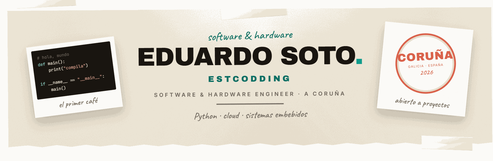
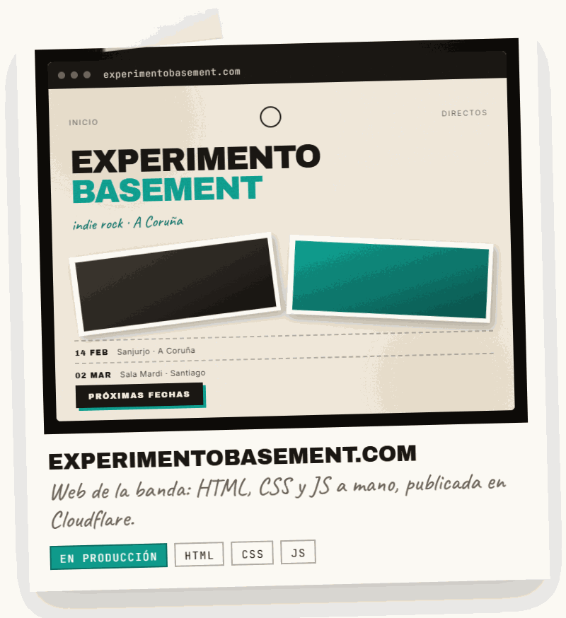
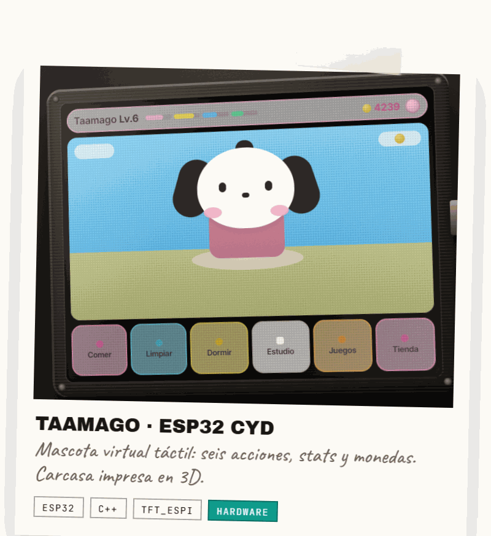
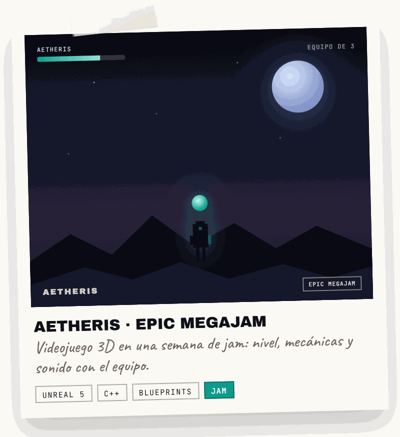
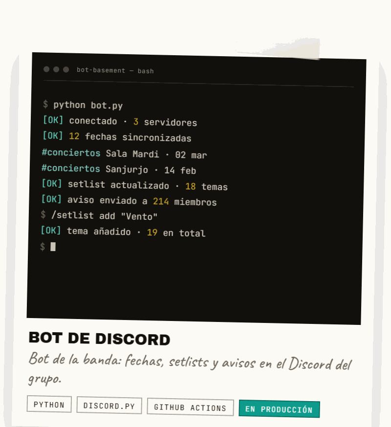
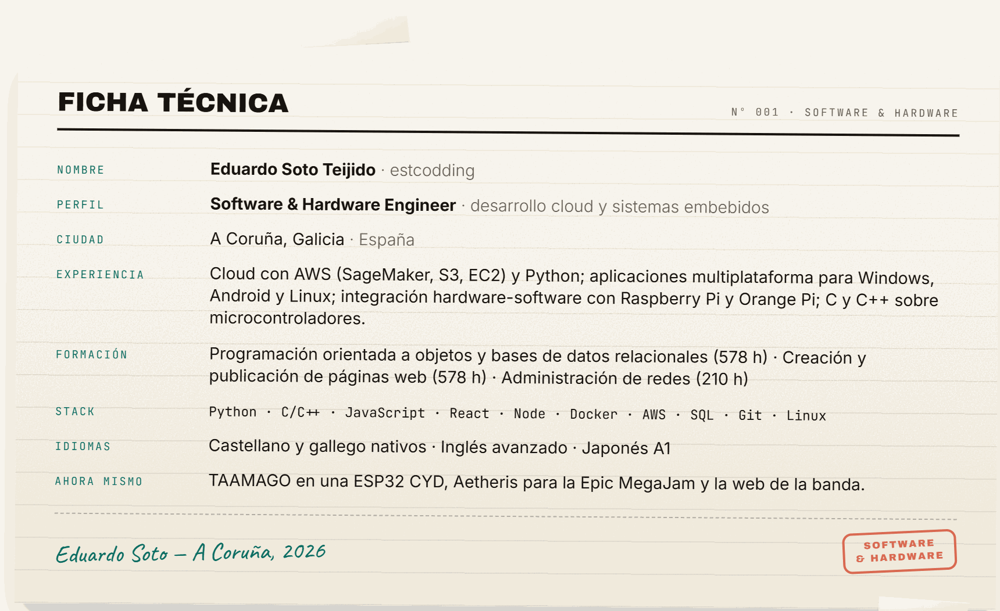
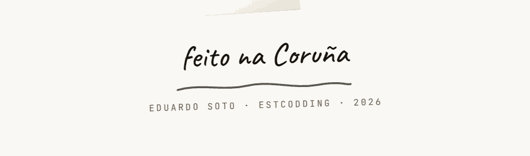

<div align="center">
  
</div>

<p align="center">
  
  
  
  
  
  
  
  
  
  
</p>

<p align="center">
  Software y hardware, de la nube al microcontrolador: AWS y Python por un lado,<br>
  C/C++ y placas por el otro. A Coruña, Galicia.
</p>

## Proyectos

<p align="center">
  <a href="https://experimentobasement.com"></a>
  
</p>

<p align="center">
  
  
</p>

## Ficha técnica

<p align="center">
  
</p>

## En la terminal

```bash
$ whoami
eduardo soto — software & hardware engineer · A Coruña
$ ls ~/stack
python  c  cpp  javascript  react  node  docker  aws  sql  git  linux
$ cat ~/ahora.txt
taamago en una ESP32 CYD, aetheris para la Epic MegaJam y la web de la banda
```

<p align="center">
  
</p>

<p align="center">
  <sub>© Eduardo Soto · A Coruña · 2026</sub>
</p>
